# Dagobert

Dagobert projects your personal wealth over your lifetime under German tax rules. You enter what
you own, what you earn and what you spend. Dagobert then computes every month from today to old
age and shows how likely it is that your money runs out. It also tracks the real values of your
assets and your real spending against the plan.

Dagobert is a web app that runs on your own computer or server. It works in a desktop browser and
on a phone, in English or in German.

## Disclaimer

Dagobert gives no tax advice, no legal advice and no financial advice. Its results are estimates
from a model. The model simplifies the law and the markets, and it can contain errors. Do not base
a decision on Dagobert alone. Before you act, ask a tax advisor (Steuerberater) or a financial
advisor. You use the software at your own risk, as the [license](LICENSE) says.

## What Dagobert does

- It computes your plan month by month: salary, pension, spending, loans, property, investments,
  savings plans, company pensions, income tax, church tax, social insurance and the tax on capital
  income.
- It computes the tax-free part of fund gains (Teilfreistellung) for each depot, and the rent of a
  property with its depreciation (AfA), its interest and its loss carryforward (§10d).
- It takes the deductions off your income: work expenses (Werbungskosten), special expenses
  (Sonderausgaben), household services (§35a) and a Basisrente. It computes Kindergeld and the child
  allowances, and the effect of an inheritance or a gift that you receive.
- It computes a business of your own: the profit, the trade tax (Gewerbesteuer), and your own
  health and pension insurance.
- It computes the contributions to the statutory health insurance (GKV) in each phase of life:
  with a salary, as a voluntary member without one, and as a pensioner. A company pension pays
  contributions too. With a private health insurance (PKV), it computes the part that your
  employer pays.
- You define the phases of your life, such as work, a career break or retirement, and the name of
  each phase on the pages. A scenario switches between these phases.
- It computes thousands of possible futures of the markets and of inflation (Monte Carlo), or it
  replays real market history. So you see the spread of the outcomes, not one number.
- It compares scenarios, for example a retirement at 63 or at 67, the loss of a job, or the sale
  of a flat.
- It compares the purchase of a home with renting. The guide
  [Buy or rent](docs/manual/buy-or-rent.md) shows how.
- It draws the risk that you can no longer work: the sick pay, the disability pension and the
  benefit of a disability insurance (BU). Two scenarios show what a BU is worth to you, for
  example one that your employer paid and that you keep or let lapse when you leave.
- It cuts your spending when the money gets short and raises it when the money is plentiful.
  Another rule, variable percentage withdrawal (VPW), sets the spending of each year from your
  wealth.
- It can realize gains of your equity each December, up to the tax-free room, to lower the tax on
  later sales.
- The chart `Will the money last?` shows by age how the possible futures split: those in which the
  money ran out, and those in which it holds a multiple of your liquid net worth.
- It finds the change that makes a plan safe enough. For example, it finds how much you can spend,
  or how early you can stop working.
- The Explorer has one slider for all your spending. The first scenario of your plan is the main
  scenario: the Overview, Cashflows, Flows and Spend pages open with it.
- You can use simple mode, which hides the settings for experts that your plan does not use. The
  page Features switches off the parts of life that your plan does not model.
- It records the values of your assets and your actual spending, and it compares them with the
  plan.
- It imports the trades of a depot from the CSV export of your broker, for example Trade
  Republic, Scalable Capital or comdirect.
- You enter and change your data in the app, on a desktop or on a phone. An export zip is a
  backup of your plan, or a copy that you work on and bring back.
- The app and the report are in English and in German. The switch `Sprache · Language` at the end
  of the sidebar changes the language of the app.

## What Dagobert does not do

- It applies the German rules of the tax year 2026 only. For later years it uses the same rules,
  with the amounts raised by inflation.
- It computes the taxes of one person, assessed alone. It does not compute a joint assessment of
  a married couple.
- Some text stays in English on the German pages: the names in your files and in the examples,
  the problems of an input file and some words of Streamlit. The user guide is in English only,
  and so are the help and the summary of the command line.
- It does not connect to your bank or your broker, and it does not download the prices of your
  funds and shares. You import the files that you download from them.

The [user guide](docs/manual/models.md#what-the-model-leaves-out) lists the other simplifications.

## Quick start with the container

You need Docker with Docker Compose and a copy of this repository. The file `compose.yaml` builds
the image from the source in this repository. To use the published image
`ghcr.io/l-mb/dagobert` instead, replace the lines `build: .` and `image: dagobert` in
`compose.yaml` with `image: ghcr.io/l-mb/dagobert:0.1`, and leave out `--build` in step 3. The
tag `0.1` always gives the newest release 0.1.x.

1. Clone this repository and go into its directory:

   ```sh
   git clone https://github.com/l-mb/dagobert.git
   cd dagobert
   ```

2. Make an empty data directory:

   ```sh
   mkdir data
   ```

3. Build the image and start the app:

   ```sh
   DAGOBERT_USER=$(id -u):$(id -g) docker compose up -d --build
   ```

4. Open <http://localhost:8321> in your browser. The app shows the page `Start a plan`, see
   [The first start](#the-first-start).

The first build takes a few minutes. `DAGOBERT_USER` makes the app write the files as your user, so
that the data directory stays yours. Make the data directory before the first start. If it does not
exist, Docker makes it for the user `root`, and the app cannot write into it. If your host uses
SELinux, add `:z` to the volume of the data directory in `compose.yaml`. To use another data
directory, set `DAGOBERT_DATA_DIR` to its path. To stop the app, run `docker compose down`.

The app listens on `127.0.0.1` only, so only this computer can open it. To open it from a phone
or from another computer, read [Privacy and access](#privacy-and-access) first.

[Run Dagobert on a server](docs/install/self-hosting.md) puts a login in front of it.

## Quick start without the container

You need [uv](https://docs.astral.sh/uv/). uv installs the correct Python version.

1. Clone this repository and go into its directory:

   ```sh
   git clone https://github.com/l-mb/dagobert.git
   cd dagobert
   ```

2. Install the dependencies:

   ```sh
   uv sync
   ```

3. Start the app. It opens a tab in your browser at <http://localhost:8321>. Its data directory
   is `data` in the current directory. The app shows the page `Start a plan`, see
   [The first start](#the-first-start).

   ```sh
   uv run dagobert app
   ```

The command line also writes a report: `uv run dagobert run data/scenarios/*.yaml` computes the
scenarios, prints a summary and writes an HTML report to `out/index.html`. The report follows the
light or dark setting of your browser and fits the screen of a phone. Its tab `Difference from …`
compares each scenario with the first one on the command line. Add `--lang de` for a report in
German. Run `uv run dagobert --help` for the other commands.

## Windows and macOS

The quick starts above are for Linux. Two guides give the steps for the other systems, with uv or
with Docker Desktop:

- [Install Dagobert on Windows](docs/install/windows.md)
- [Install Dagobert on macOS](docs/install/macos.md)

The author did not test these guides. The automatic tests of Dagobert run on Windows and macOS,
but nobody used the app there by hand. If you try a guide, please tell us the result in an issue
or a pull request: a confirmation that the steps work, or a correction.

## The first start

If the data directory is empty or does not exist, the app shows the page `Start a plan` instead of
the other pages. It gives you three choices.

- `Start from the simple example` or `Start from the full example` copies the data of an example
  into the data directory, and then opens the Overview. Use one to try Dagobert before you enter
  your own data.
- `Start my plan` under `Quick start` writes your plan from a few numbers: your date of birth, and
  if you want, your salary, spending, savings, cash, pension points and a savings plan, and your
  goals: an age to stop working, a job loss to check, a property that you own. With a salary and
  under 67 the Overview opens and finds by when you can stop working. Otherwise the Assumptions
  page opens. Add the rest on the Assets, Cashflows and Scenarios pages.
- `Import` under `An export` takes the export zip of your plan from another instance or from a
  backup, and then opens the Overview.

On the command line, `uv run dagobert init --example starter` copies the simple example,
`uv run dagobert init --example` the full example, `uv run dagobert init --born 1985-03-14` writes
an empty plan, and `uv run dagobert import <zip>` imports an export. In the
container, run `DAGOBERT_USER=$(id -u):$(id -g) docker compose run --rm dagobert init --example`.
A data directory that holds a plan stays as it is. Other commands, such as `dagobert run`, stop with
a message on an empty data directory.

## The example data

Dagobert has two examples. All names, amounts and securities in them are made up. They are part of
the app, in `src/dagobert/examples/`.

The simple example, in `starter`, is a small plan to learn the app. The person is 31, single, and
an employee with about 70,000 € a year and a bonus of 10%. She pays into a company pension from her
salary, an Altersvorsorgedepot and an ETF savings plan of 500 € a month into a fund on the MSCI
World. She rents a flat, is in the statutory health insurance (GKV) and spends about the average of
a person who lives alone in Germany. She wants to stop working early. Its scenarios are
`Mit 55 aufhören`, `Arbeiten bis 67` and `Teilzeit ab 40`. The names and notes of this example are
in German, even if you use the app in English. On the Overview, `Find when to stop working` finds
the earliest month that keeps her chance to run out of money low. The parts of the app that the
example does not use, such as property or gold, are off. The page Features turns them on.

The full example, in `engineer`, is the plan of a made-up engineer. The person was born in 1986,
has one child and private health insurance (PKV), rents a home and owns a rented-out flat with a
loan. The example uses most features of Dagobert. Its names and notes are in English.

It has ten scenarios: `Work to 65` (the plan), `Job loss at 53`, `Sabbatical at 45`,
`Self-employed at 42`, `Self-employed at 42 without the BU` (the same without disability
insurance), `Unable to work at 51`, `Keep the flat`, `Buy a home`, `Spend by VPW` and
`Stress test`. `Buy a home` extends the
plan with the purchase of a flat. With the plan, it is the example of the guide
[Buy or rent](docs/manual/buy-or-rent.md).

The dates of the examples are fixed: their simulation starts in October 2026. If you start from
one later, the Overview offers to move the start forward and marks the asset values as old. This
is correct behavior for a plan that nobody updated.

## Your data

All your data stays in one directory, the data directory. It holds:

- the inputs: `assumptions.yaml`, `assets.yaml`, `cashflows.yaml`, `app.yaml` and the scenarios in
  `scenarios/`
- your records: the observed asset values in `history.csv`, the actual spending in `actuals.csv`
  and the prices of your securities in `prices/`
- `manifest.yaml`, which the app writes: the version of the file format
- the revisions in `revisions/`
- the external series that you fetched or imported, in `series/`.

You change your inputs and records in the app:

- The Assumptions page edits the facts about you and the assumptions of every scenario, such as the
  inflation, the returns, the rules and the tax. It also edits the phases of your life and their
  names on the pages.
- The Scenarios page creates, copies, renames and deletes scenarios. It edits their phases, their
  events and their overrides, and it sets the scenarios that the Explorer opens with.
- The Assets page edits your assets and the trades of your securities. It also imports the trades
  from the export of your broker.
- The Cashflows page edits your income and your spending.
- The Snapshot page records the values of your assets and the prices of your securities.
- The Spend page records your actual spending.
- The Explorer saves the positions of its sliders as a new scenario.

The simulation start is read only: the roll forward on the Overview moves it. Other files use the
ID of an asset, the name of a stream and the short name of a phase. To change one of them, press
`Rename` on the Assets, Cashflows or Assumptions page. The app then changes the name in every file
that uses it, in one save. [configuration.md](docs/manual/configuration.md) describes each file.
The first save of a file in the app changes the layout of the file one time, but its comments
stay.

Every save is a revision: the app copies each file that the save changed into `revisions/` and
adds a line to `revisions/log.csv`. The app uses the revisions to compare your plan with the plan
of an earlier day. If you change a file by hand, the app records the change as `outside the app`
when it next loads a page. If a new version of Dagobert changes the file format, the app updates the
data directory at its first start. This update is a revision too.

Keep the data directory on a local file system: a save locks the directory, and the lock does not
work on every network file system.

## Backup and local work

An export is a zip file of your data directory. It holds the inputs, your records and the prices of
your securities. If you turn on `Include change history`, it also holds the revisions. It does not
hold the fetched series in `series/`. Make an export on the page `Export and import` in the section
Setup, or on the command line:

```sh
uv run dagobert export --data data --revisions
```

Use an export for these tasks:

- A backup. Make one before you update Dagobert. If the update converts the data directory to a
  new file format, an older version cannot open it. To restore the backup, import it into an empty
  data directory, on the page `Start a plan` (see [The first start](#the-first-start)). A copy of
  the whole data directory, `revisions/` included, is also a backup.
- A move to a new instance. Import the export there in the same way.
- Local work on a copy of your plan, for example of a plan on a server. Download the export, and
  then run `uv run dagobert app --data dagobert-<revision>.zip` in a checkout of this repository.
  The command unpacks the zip into the directory `dagobert-<revision>` next to it and opens the app
  on that copy. To bring your changes back, export the copy, and then import that zip on the page
  `Export and import` of your instance.

The import compares each file of the zip with your data directory. If a file changed on both sides
since the export, you choose which one to keep. Nothing changes before you press `Import`. The
guide [Export and import](docs/manual/transfer.md) describes each step.

## External data

Some data comes from public sources:

- Dagobert ships the German consumer prices (Destatis and Deutsche Bundesbank), the yield of German
  bonds (Bundesbank) and the gold price (World Bank). It also ships two exchange rates (Bundesbank
  and ECB) and the German life table (Destatis). Their terms allow this with a source note.
  [SOURCES.md](src/dagobert/data/SOURCES.md) gives the source, the terms and the source note of
  each file. The Data page of the app shows the same notes.
- The MSCI World index and the Bitcoin prices do not ship, because their terms allow only
  non-commercial use. You fetch them yourself with a button on the Data page, or you import an
  MSCI World history from a CSV file. They stay in your data directory, for your personal use.
  Without the MSCI World series, the historical model is not available.
- The prices of your funds and shares do not come from the internet. The terms of the free price
  sites do not allow automated queries. You import a price history that you downloaded as a CSV
  file, or you type a price on the Snapshot page.

Dagobert fetches data only when you press a fetch button on the Data page or run
`dagobert series fetch`. Nothing is fetched on a timer or at the start.

## Privacy and access

The app has no login and no user accounts. Everybody who can open the app sees and changes the same
data. So one instance of the app serves one person, with one data directory.

By default, the app listens on `localhost` only. If you want to open it from a phone or from
another computer, put a reverse proxy in front of it that authenticates every request. The file
`Caddyfile` is an example for Caddy with forward authentication (single sign-on), and the profile
`server` in `compose.yaml` starts it. Never publish the port of the app itself on all network
interfaces.

Dagobert does not make its files private. A new file gets the permissions that your umask allows.
The umask is a setting of the system that removes permissions from new files, and on most systems
it lets other users read them. If other people have an account on your computer, make the
directory that holds the data directory private. For the quick starts above, that is the directory
of your clone, which also holds the reports in `out`. In that directory, run:

```sh
chmod 700 .
```

## Documentation

- [User guide](docs/manual/index.md): the pages of the app, the models and the meaning of the
  results.
- [Windows](docs/install/windows.md) and [macOS](docs/install/macos.md): install Dagobert on
  these systems (not tested by the author).
- [Run Dagobert on a server](docs/install/self-hosting.md): the container behind a login.
- [Configuration reference](docs/manual/configuration.md): the input files, field by field.
- [How the simulation works](docs/manual/models.md): the three models and what P(broke) means.
- [Export and import](docs/manual/transfer.md): backups, and work on a copy of your plan.
- [Buy or rent](docs/manual/buy-or-rent.md): compare the purchase of a home with renting.
- [Adding a tax year](docs/manual/adding-a-tax-year.md): for contributors.
- [Data sources](src/dagobert/data/SOURCES.md): the shipped series and their terms.

## Development

Clone the repository and run:

```sh
uv sync
uv run pre-commit install
```

The hook runs gitleaks, a check for personal data (`scripts/pii-check`) and the linters before each
commit. The check for personal data reads a private list of terms from
`~/.config/dagobert/pii-terms` (or the file in `DAGOBERT_PII_TERMS`). Without that file it passes
and prints a note that it checked nothing.
Before you commit, run the quality gates and they must all pass:

```sh
uv run ruff check src tests scripts
uv run ruff format src tests scripts
uv run mypy
uv run basedpyright
uv run pytest
```

The tests never read `data/`. [CLAUDE.md](CLAUDE.md) lists the commands and the rules for every
change. The rules of each area are in [.claude/rules/](.claude/rules/). The user guide is in
`docs/manual/`, and it must match the code.

## Screenshots

The screenshots show the full example, except the Cashflows page, which shows the simple example.

The Overview: the net worth, the outlook of the plan with the answer of `Find when to stop
working`, and the items that need your attention. The language switch ends the sidebar.

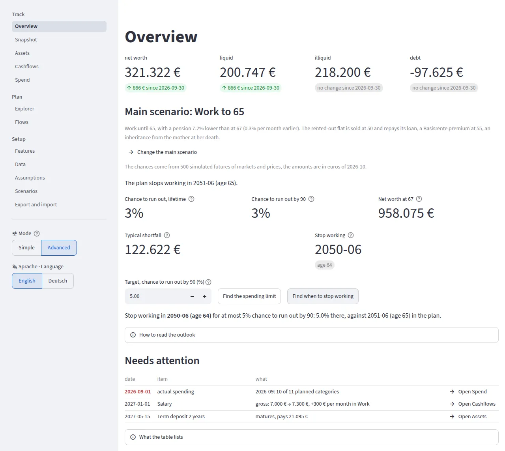

The Explorer with two scenarios: the sliders, the results side by side and the median net worth
by age.

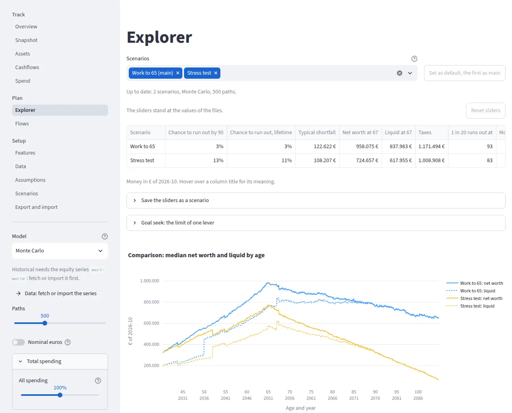

The spread of the liquid net worth of one scenario over all paths, with its events.

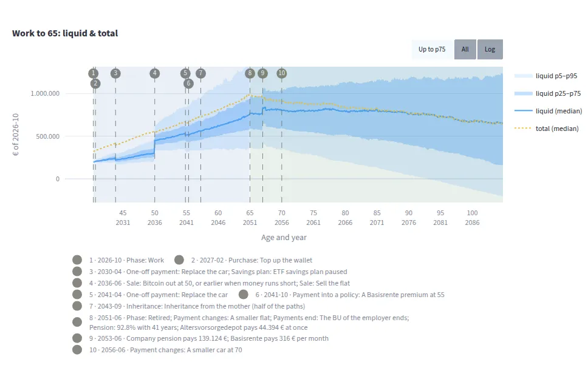

The Flows page: where the money goes in one phase, per month.

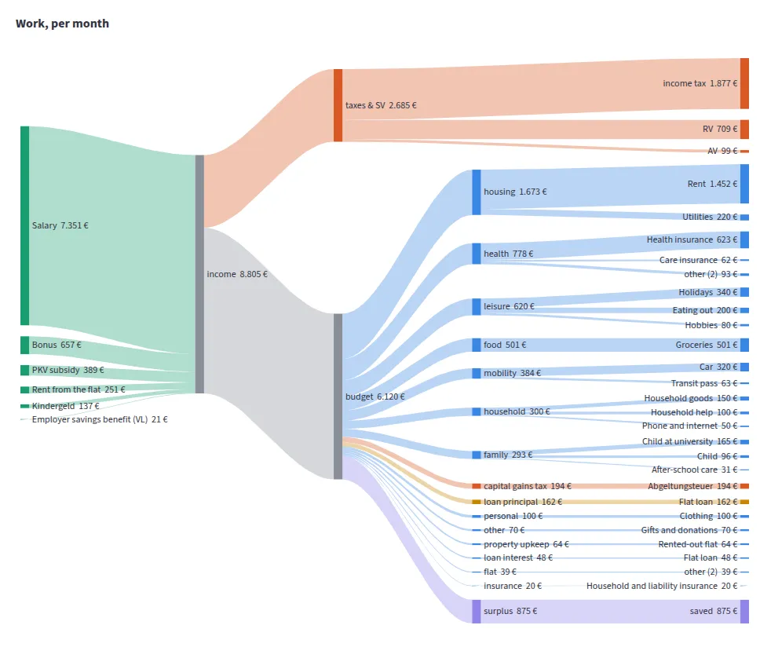

The Cashflows page of the simple example, whose data is German: the income and the spending of
the scenario `Mit 55 aufhören` (stop working at 55) in each phase.

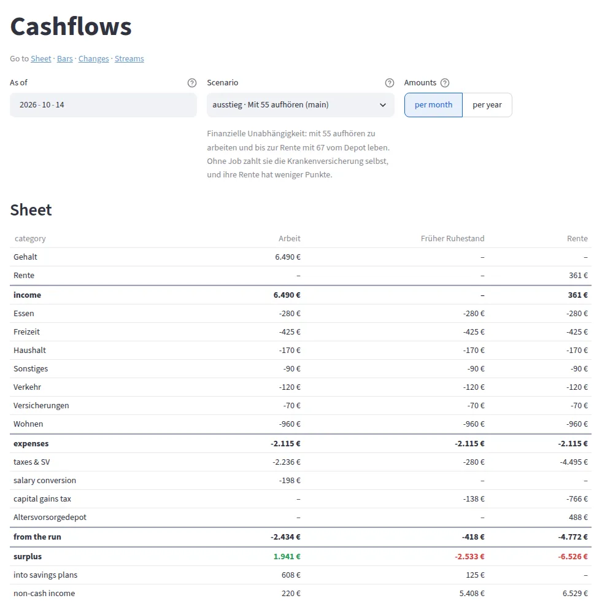

The Spend page: the actual spending against the plan.

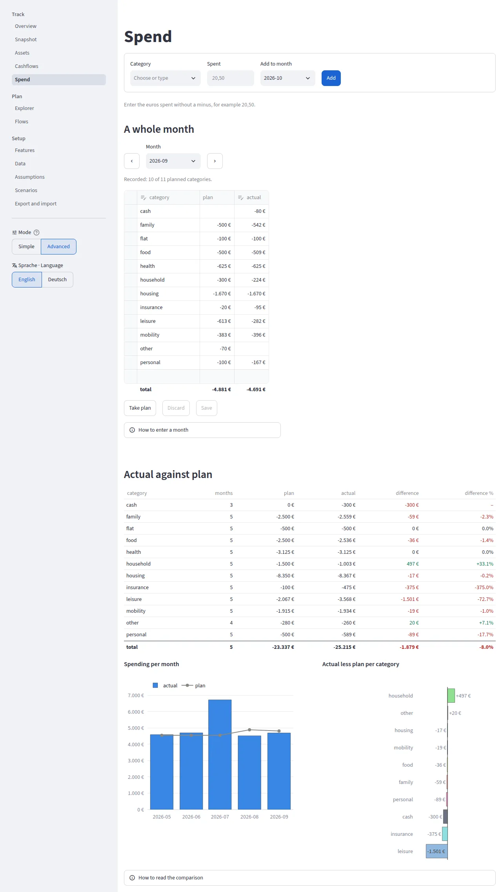

The Snapshot page: the values of your assets, with estimates from the prices of your securities.

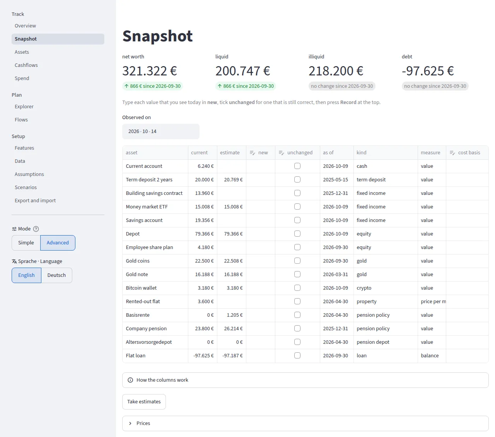

The Scenarios page: the purchase of a home in the scenario `Buy a home`, and the events that it
takes from the plan.

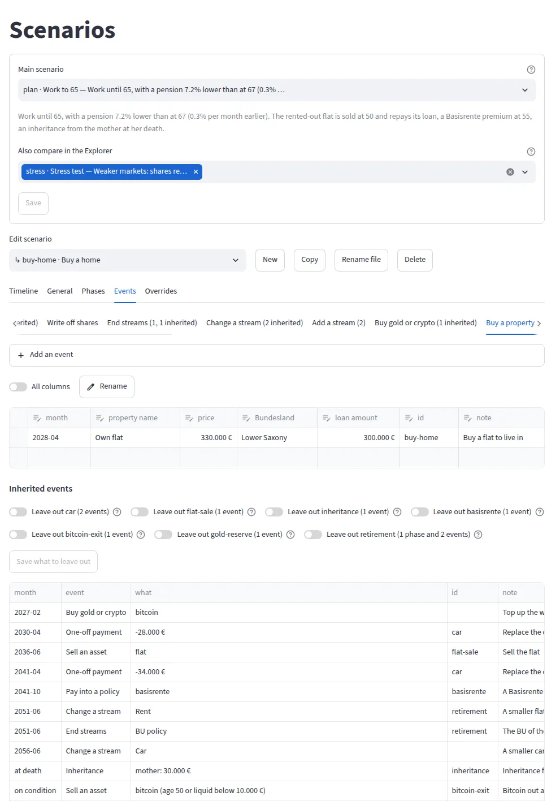

The Assumptions page: the phases of life, each with its name on the pages and its short name in
the files. `Rename` changes a short name in every file.

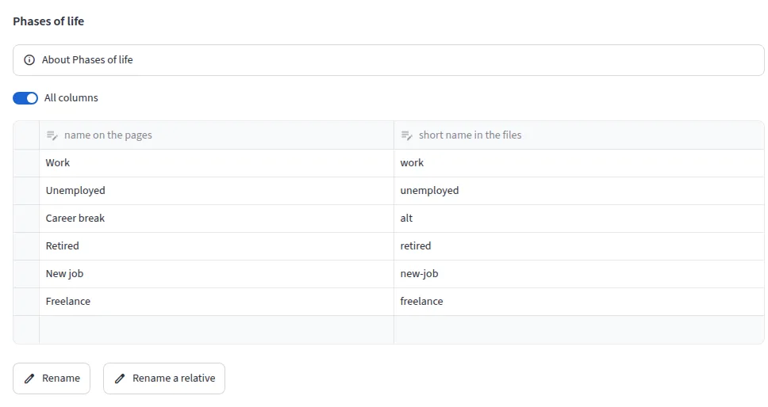

The Data page: the external series and their sources.

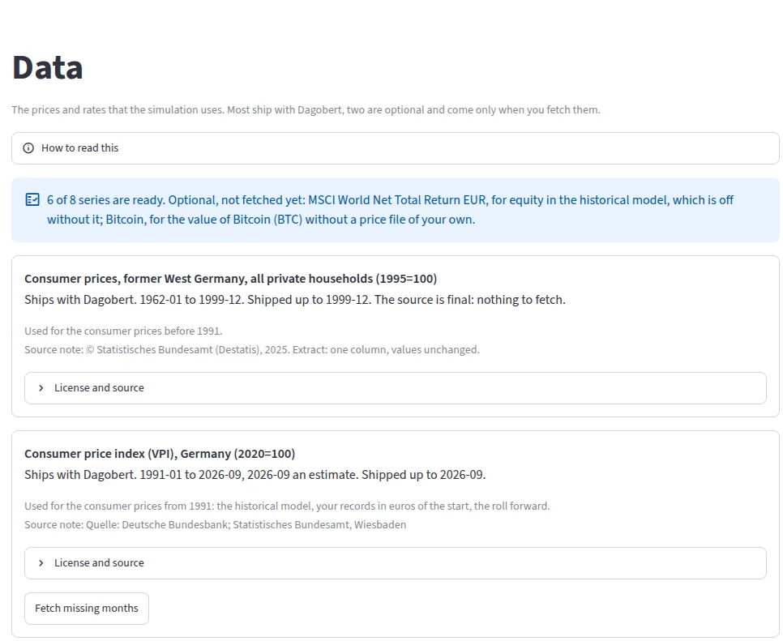

The Overview on a phone, in portrait.

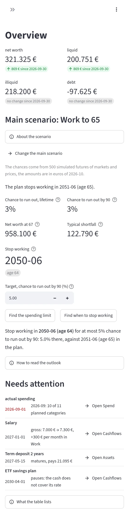

## License

Dagobert is free software under the [0BSD license](LICENSE). Its dependencies use permissive
licenses (Apache-2.0, BSD, MIT and similar), and one (certifi) uses the MPL-2.0. At each change,
the CI makes sure that no other dependency uses a copyleft license.
